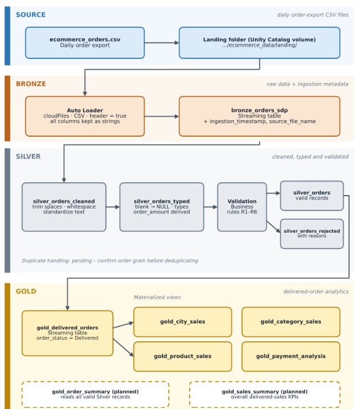

# E-Commerce Sales Data Engineering Pipeline

An end-to-end data engineering project that ingests daily e-commerce order files, cleans and validates them, and produces business-ready sales analytics and dashboards using **Medallion Architecture (Bronze → Silver → Gold)** on **Databricks**.



---

## Table of Contents
1. [Project Overview](#project-overview)
2. [Tech Stack](#tech-stack)
3. [Repository Structure](#repository-structure)
4. [Source Data](#source-data)
5. [Pipeline Layers](#pipeline-layers)
6. [Data Quality Rules](#data-quality-rules)
7. [Pipeline Execution](#pipeline-execution)
8. [Dashboards](#dashboards)
9. [How to Run](#how-to-run)
10. [Key Learnings](#key-learnings)
11. [Future Improvements](#future-improvements)
12. [Author](#author)

---

## Project Overview

Daily order-export CSV files land in a Unity Catalog volume. The pipeline:

- **Ingests** them incrementally with Auto Loader and keeps the raw data untouched (**Bronze**)
- **Cleans, types and validates** the records, sending invalid rows to a rejected table with reasons (**Silver**)
- **Aggregates** orders into business metrics by city, category, product, payment mode and order status (**Gold**)
- **Visualizes** the results in dashboards for sales, products, payments and the order lifecycle

The pipeline is built with **Lakeflow Spark Declarative Pipelines (SDP)** using Python/PySpark.

## Tech Stack

| Component | Used for |
|---|---|
| Databricks Free Edition | Development and execution platform |
| Lakeflow Spark Declarative Pipelines | Declarative definition and management of pipeline tables |
| Apache Spark / PySpark | Transformation logic |
| Auto Loader (`cloudFiles`) | Incremental CSV ingestion |
| Delta Lake | Table storage |
| Unity Catalog volume | Landing location for source files |
| Dashboards | Business reporting on the Gold layer |

## Repository Structure

```
ecommerce-sales-data-engineering-pipeline/
├── README.md
├── transformations/           # Pipeline source code (Bronze, Silver, Gold)
├── ecommerce_orders.csv       # Source dataset
├── Architecture.png           # End-to-end architecture diagram
├── Pipeline graph.png         # Pipeline run graph from Databricks
├── Execeutive Overview.png    # Dashboard: executive overview
├── Sales Analysis.png         # Dashboard: sales analysis
├── Product Analysis.png       # Dashboard: product analysis
├── Payment Analysis.png       # Dashboard: payment analysis
└── Order Lifecycle.png        # Dashboard: order lifecycle
```

## Source Data

Order-export file: `ecommerce_orders.csv`

| Column | Bronze type | Silver type |
|---|---|---|
| order_id | String | String |
| order_date | String | Date |
| customer_id | String | String |
| customer_name | String | String |
| city | String | String |
| product_name | String | String |
| category | String | String |
| quantity | String | Integer |
| unit_price | String | Decimal(12,2) |
| payment_mode | String | String |
| order_status | String | String |

## Pipeline Layers

### 🥉 Bronze: raw ingestion
- Auto Loader reads new CSV files from the landing folder incrementally
- All source columns are kept as **strings**, with no business cleaning applied
- Adds `ingestion_timestamp` and `source_file_name` for traceability
- Table: `bronze_orders_sdp`

### 🥈 Silver: cleaned and validated
1. Trim spaces and normalize repeated whitespace
2. Standardize text fields (title case for names, cities, products and categories; upper case for payment mode)
3. Convert blank strings to `NULL`
4. Convert `order_date` to DATE, `quantity` to INT and `unit_price` to DECIMAL(12,2), using safe casts so bad values become `NULL` instead of failing the pipeline
5. Derive `order_amount = quantity × unit_price`
6. Apply business validation rules (below)

Tables: `silver_orders_cleaned`, `silver_orders_typed`, `silver_orders` (valid records) and `silver_orders_rejected` (invalid records with reasons).

### 🥇 Gold: business analytics
**Business rule:** revenue-based analysis uses **Delivered orders only**, so cancelled, returned, pending and shipped orders do not inflate sales revenue. They remain in Silver for the order lifecycle summary.

| Table | Purpose |
|---|---|
| `gold_delivered_orders` | Reusable input with only Delivered records |
| `gold_city_sales` | Orders, revenue, average order value and rank by city |
| `gold_category_sales` | Orders, units, revenue, average order value and rank by category |
| `gold_product_sales` | Orders, units, revenue, average selling price and rank by product |
| `gold_payment_analysis` | Orders, revenue, average transaction value and rank by payment mode |
| `gold_order_summary` | Order status distribution across all valid Silver records |
| `gold_sales_summary` | Overall delivered-sales KPIs |

## Data Quality Rules

Records failing any rule are written to `silver_orders_rejected` with the rejection reason(s). They are never silently dropped.

| Rule | Field | Requirement |
|---|---|---|
| R1 | order_id | Must not be NULL or empty |
| R2 | order_date | Must be a valid date |
| R3 | quantity | Must be greater than zero |
| R4 | unit_price | Must be greater than zero |
| R5 | customer_id, product_name, category, city, payment_mode | Must not be empty |
| R6 | order_status | Must be Delivered, Shipped, Pending, Cancelled or Returned |

Customer name is allowed to be empty according to the project specification.

**Reconciliation checks**
- Bronze row count matches the source CSV record count
- Bronze count = valid + rejected + duplicates removed
- Gold revenue by city, category, product and payment mode reconciles to the total in `gold_delivered_orders`
- Duplicate handling follows the true business grain, because `order_id` alone is not assumed unique if an order can have several product lines

## Pipeline Execution


| Metric | Value |
|---|---|
| Source records ingested (Bronze) | [number] |
| Valid records (Silver) | [number] |
| Rejected records | [number] |
| Total delivered revenue | [amount] |

## Dashboards

### Executive Overview
[Executive Overview]

### Sales Analysis


### Product Analysis


### Payment Analysis


### Order Lifecycle


## How to Run

1. Create a Databricks workspace (Free Edition works) and a Unity Catalog volume for landing files
2. Upload `ecommerce_orders.csv` to the landing folder
3. Create a Lakeflow Spark Declarative Pipeline and add the files from the `transformations/` folder as source files
4. Set the pipeline's target catalog and schema, and make sure the source path and table references in the code match your workspace
5. Run the pipeline and confirm all tables complete successfully
6. To test incremental loading, add a second CSV to the landing folder and run the pipeline again
7. Build dashboards on the Gold tables

> **Note:** do not place checkpoint or schema-tracking folders inside the landing directory when using Lakeflow pipelines.

## Key Learnings

- Keeping Bronze raw makes the pipeline easier to debug and trust
- Safe type casting plus a rejected table beats silently dropping bad data
- Deduplication must follow the real business grain, not just an ID column
- Delivered-only revenue prevents non-delivered orders from inflating sales
- Declarative pipelines manage table dependencies and state, so the code stays focused on transformation logic

## Future Improvements

- Scheduled pipeline runs and failure alerts
- Expectations-based data quality monitoring
- Additional sources (customers, products, returns)
- Power BI version of the dashboards

## Author

**kale.Divya sreee**
GitHub: https://github.com/divyasreesree725-boop
LinkedIn:https://www.linkedin.com/in/divya-sree-kale-692673331
